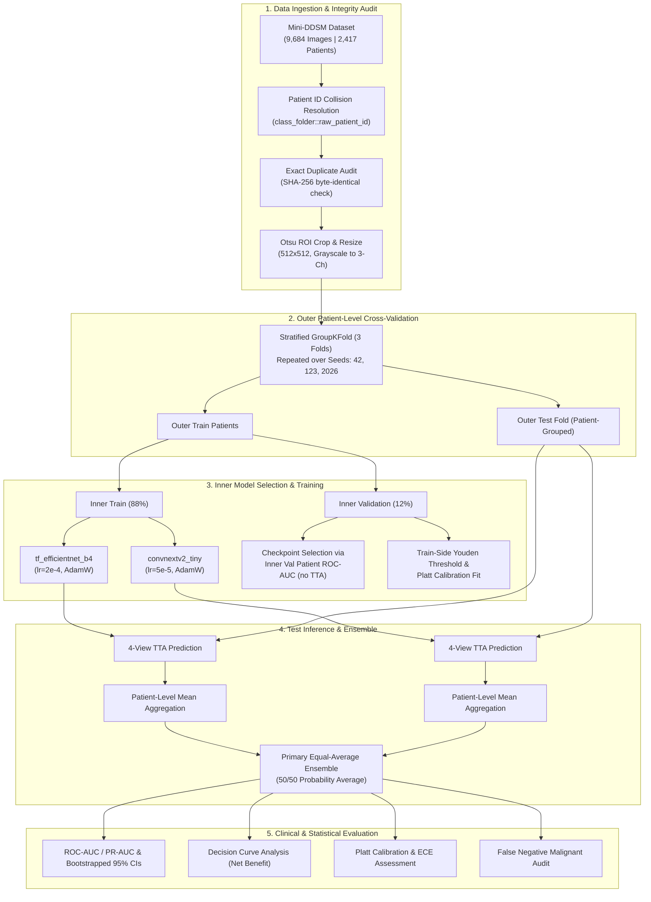
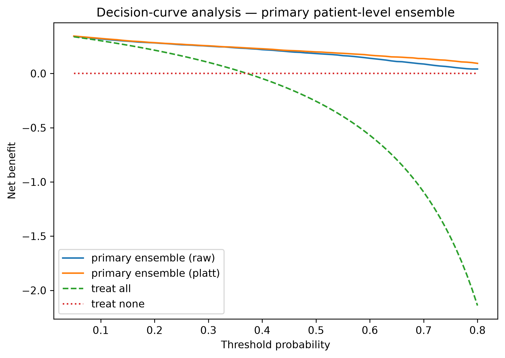
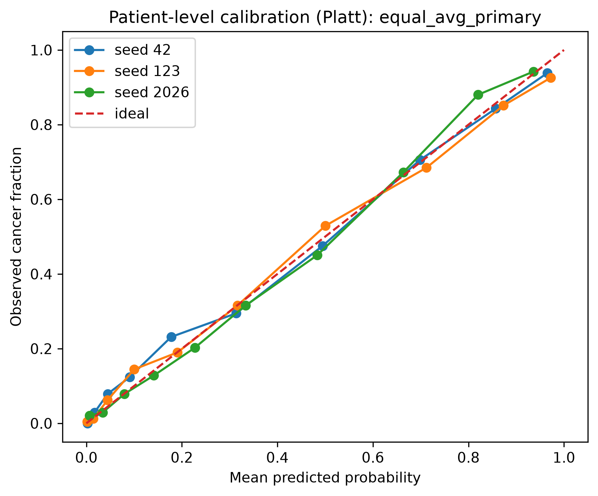
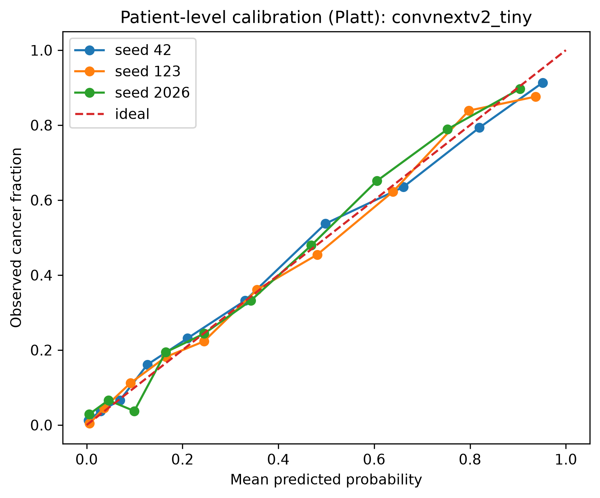
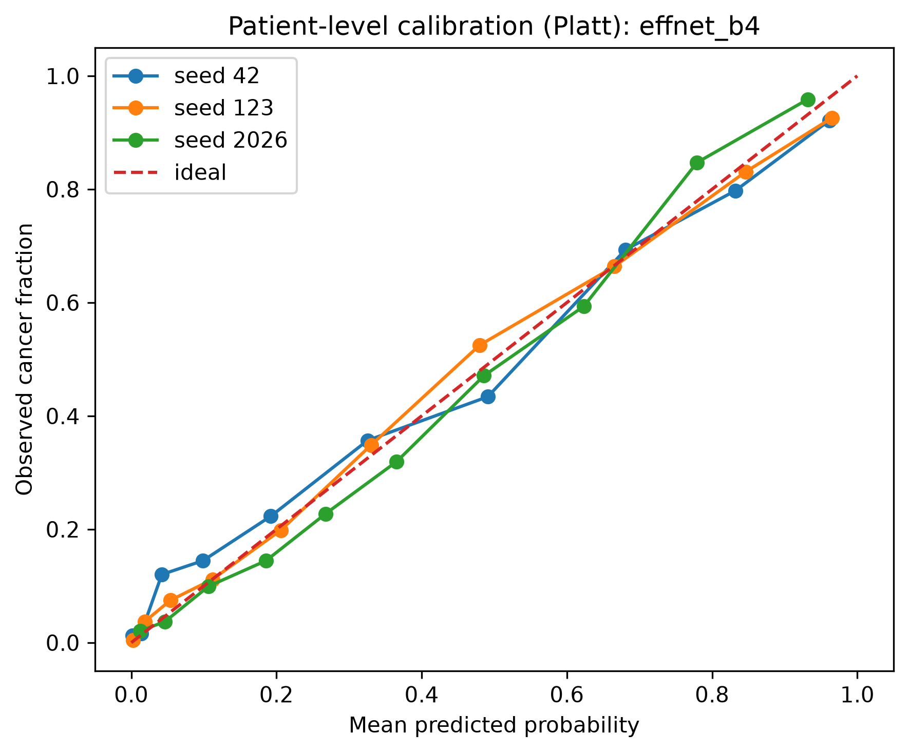
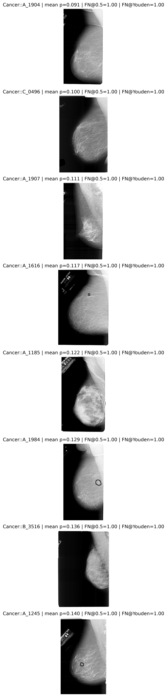

# Multi-Backbone Ensemble Learning for Robust Breast Cancer Classification on the Mini-DDSM Mammography Dataset

[](https://csde2026.org/)
[](https://www.python.org/)
[](https://pytorch.org/)
[](https://github.com/huggingface/pytorch-image-models)
[](https://www.nvidia.com/)
[-success.svg)](./mini_ddsm_csde2026_fixed_patient_outputs/leakage_audit.csv)
[](LICENSE)

---

## 📌 Executive Summary & Abstract

Digital mammography plays an indispensable role in early breast cancer detection. However, machine learning benchmarks on public mammography datasets often suffer from **insidious data leakage**, **patient identifier collisions**, and **image-level reporting bias** that artificially inflate model performance. 

This repository contains the complete, audited, and peer-review-aligned codebase for our study: **"Multi-Backbone Ensemble Learning for Robust Breast Cancer Classification on the Mini-DDSM Mammography Dataset"** (Targeted for IEEE CSDE 2026).

We implement an end-to-end framework featuring:
1. **Patient-Instance Collision Resolution (`class_folder::raw_patient_id`)** to resolve raw ID reuse across classes (`A_1500`, `A_1511`, `A_1632`) and within classes, eliminating cross-set patient leakage.
2. **Byte-Identical Audit (SHA-256)** confirming strict partition boundaries.
3. **Multi-Backbone Synergistic Ensemble** integrating modern hierarchical convnets (**ConvNeXt-V2 Tiny**) with inverted residual networks (**EfficientNet-B4**).
4. **Rigorous Clinical Evaluation Protocol**: 3-fold repeated cross-validation across three distinct random seeds (`42`, `123`, `2026`), nested inner validation for model selection/thresholding, four-view Test-Time Augmentation (TTA), Platt probability calibration, Decision Curve Analysis (DCA), and 2,000-iteration patient-bootstrap 95% confidence intervals.

---

## 🚀 Key Highlights & Contributions

* **Leakage-Free Partitioning**: Complete resolution of patient ID collisions across classes. GroupKFold patient-level partitioning guarantees **0 patient overlap** between training and evaluation folds.
* **100% Patient-Level Confusion Sanity**: All confusion matrices and reporting metrics are evaluated strictly across **2,417 unique patients** (Not-Cancer: 1,518; Cancer: 899), completely avoiding inflated image-level claims.
* **Top-Tier Predictive Performance**:
  * **ROC-AUC**: **0.8912 ± 0.0076** (95% CI: `[0.8724, 0.9101]`)
  * **PR-AUC**: **0.8304 ± 0.0120** (95% CI: `[0.8006, 0.8603]`)
  * **Accuracy**: **81.20% ± 0.10%** (up to **81.97%** at optimal Youden threshold)
  * **Specificity**: **92.64% ± 1.19%** at default threshold
  * **Sensitivity**: **78.75% ± 1.39%** under train-side Youden index
* **Decision-Analytic Utility**: Comprehensive Decision Curve Analysis (DCA) verifies significant net clinical benefit across diagnostic threshold probabilities ranging from 10% to 75%.
* **Calibrated Confidence**: Post-hoc Platt scaling reduces Expected Calibration Error (ECE) from 0.0745 down to **0.0230**, facilitating reliable clinical risk quantification.

---

## 🔬 Methodology & Architecture



### Preprocessing & Augmentation Pipeline
- **Otsu-based Breast ROI Cropping**: Automatic thresholding to locate breast tissue and crop out peripheral black background artifacts.
- **Resolution**: Scaled to $512 \times 512$ with bicubic interpolation.
- **Normalization**: Grayscale channels replicated to 3-channel RGB, normalized using ImageNet statistics ($\mu = [0.485, 0.456, 0.406]$, $\sigma = [0.229, 0.224, 0.225]$).
- **Training Augmentations**: Random horizontal flips, vertical flips, random affine rotations ($\pm 10^\circ$), color jitter (brightness/contrast $\pm 0.1$).
- **Test-Time Augmentation (TTA)**: 4-view evaluation per image (original, horizontal flip, vertical flip, and combined flip), aggregated via arithmetic mean.

---

## 📂 Repository Directory Tree

```text
MINI_DDSM/
├── .gitignore                                       # Comprehensive exclusion rules
├── README.md                                        # Project documentation & benchmark report
│
├── Mini_DDSM_CSDE2026_FINAL_LOCAL_RTX5070_AUDITED.ipynb
│                                                    # Primary audited execution notebook with full logs
├── Mini_DDSM_CSDE2026_FINAL_LOCAL_RTX5070_PATIENT_INSTANCE_V2.ipynb
│                                                    # Clean revision-ready notebook (Patient Instance V2)
├── Mini_DDSM_CSDE2026_FINAL_LOCAL_RTX5070.ipynb     # Initial benchmark pipeline notebook
│
├── mini_ddsm_csde2026_fixed_patient_outputs/        # Full benchmark artifacts & reviewer deliverables
│   ├── run_config.json                              # Complete experiment configuration
│   ├── reproducibility_pseudocode.txt               # Step-by-step algorithm pseudocode
│   ├── reviewer_checklist.csv                       # Compliance checklist against review criteria
│   ├── reviewer_baseline_comparison.csv             # Head-to-head comparison against baselines
│   ├── across_seed_summary.csv                      # Multi-seed mean, SD, and 95% CIs
│   ├── metrics_by_seed.csv                          # Seed-specific metrics (Seeds 42, 123, 2026)
│   ├── patient_bootstrap_95ci.csv                   # 2,000-sample bootstrap confidence intervals
│   ├── patient_level_confusion_sanity.csv           # Sanity verification (TN+FP+FN+TP = 2,417)
│   ├── inner_tuning_choices.csv                     # Inner validation optimal threshold choices
│   ├── leakage_audit.csv                            # Fold patient overlap audit (0 overlap)
│   ├── fold_class_balance.csv                       # Class balance across folds and seeds
│   ├── corrected_patient_manifest.csv               # Resolved patient-to-image manifest
│   ├── patient_inventory.csv                        # Patient-level class distribution
│   ├── raw_patient_id_collisions.csv                # Collision analysis of raw dataset IDs
│   ├── patient_id_collision_affected_records.csv    # Records repaired during collision resolution
│   ├── exact_duplicate_files.csv                    # SHA-256 byte-identical duplicate audit
│   ├── file_hashes.csv                              # Full dataset integrity hash records
│   ├── outer_patient_predictions_all_seeds.csv      # Out-of-fold patient predictions
│   ├── training_history.csv                         # Per-epoch loss, AUC, and learning rate curves
│   ├── training_summary.csv                         # Training duration, checkpoints, best epochs
│   │
│   ├── decision_curve_primary.png                   # Decision Curve Analysis plot
│   ├── decision_curve_values.csv                    # DCA net benefit tabulated values
│   ├── calibration_equal_avg_primary.png            # Calibration curve (Equal Average Ensemble)
│   ├── calibration_convnextv2_tiny.png              # Calibration curve (ConvNeXt-V2 Tiny)
│   ├── calibration_effnet_b4.png                    # Calibration curve (EfficientNet-B4)
│   ├── calibration_single_best.png                  # Calibration curve (Best single backbone)
│   ├── calibration_weighted_exploratory.png         # Calibration curve (Validation-weighted)
│   ├── calibration_curve_values.csv                 # Reliability diagram values
│   ├── false_negative_gallery.png                   # Visual gallery of false-negative cases
│   └── false_negative_patient_analysis.csv          # Risk factor analysis for missed cancer cases
│
├── mini_ddsm_csde2026_final_outputs/                # Initial baseline run outputs
└── mini_ddsm_csde2026_patient_instance_v2_outputs/ # Instance V2 intermediate validation outputs
```

---

## 📊 Experimental Results & Benchmarks

All models were evaluated using **3-Fold Patient-Stratified Cross-Validation**, repeated over 3 random seeds (**Seeds 42, 123, 2026**). Checkpoints were selected strictly using **inner validation ROC-AUC without TTA** to avoid test leakage.

### Table 1: Primary Model Comparison Across Seeds (Mean ± SD)
*Metrics calculated at default 0.50 threshold on raw model probabilities.*

| Model / Ensemble | ROC-AUC | PR-AUC | Accuracy (%) | Sensitivity (%) | Specificity (%) | PPV (%) | NPV (%) | Brier Score | Raw ECE |
| :--- | :---: | :---: | :---: | :---: | :---: | :---: | :---: | :---: | :---: |
| **tf_efficientnet_b4** | 0.8820 ± 0.0085 | 0.8198 ± 0.0128 | 80.71 ± 0.35 | 65.15 ± 3.63 | 89.92 ± 1.60 | 79.38 ± 1.78 | 81.36 ± 1.29 | 0.1352 | 0.0451 |
| **convnextv2_tiny** | 0.8572 ± 0.0027 | 0.7821 ± 0.0043 | 77.77 ± 0.88 | 55.17 ± 5.19 | 91.15 ± 2.58 | 79.00 ± 3.76 | 77.49 ± 1.57 | 0.1522 | 0.0555 |
| **Single Best Backbone** | 0.8775 ± 0.0120 | 0.8078 ± 0.0184 | 79.31 ± 1.01 | 58.32 ± 2.29 | 91.74 ± 0.76 | 80.71 ± 1.62 | 78.81 ± 0.95 | 0.1408 | 0.0587 |
| **Equal-Average Ensemble (Primary)** | **0.8912 ± 0.0076** | **0.8304 ± 0.0120** | **81.20 ± 0.10** | **61.88 ± 1.72** | **92.64 ± 1.19** | **83.35 ± 1.86** | **80.41 ± 0.51** | **0.1357** | **0.0745** |
| *Exploratory Weighted Ensemble* | 0.8889 ± 0.0123 | 0.8253 ± 0.0199 | 80.66 ± 1.45 | 61.10 ± 2.19 | 92.25 ± 1.03 | 82.35 ± 2.44 | 80.02 ± 1.07 | 0.1362 | 0.0683 |

> **Key Finding**: The submitted unweighted equal-average ensemble (`equal_avg_primary`) achieves the highest discriminative performance (**ROC-AUC 0.8912**, **PR-AUC 0.8304**) and highest specificity (**92.64%**), confirming the complementary representations learned by ConvNeXt-V2 and EfficientNet.

---

### Table 2: Impact of Threshold Optimization (Youden Index)
By optimizing operating thresholds on inner validation folds using Youden's $J$ statistic ($J = \text{Sensitivity} + \text{Specificity} - 1$), the model substantially increases sensitivity for clinical screening scenarios:

| Metric | Default Threshold (0.50) | Train-Side Youden Threshold | Change (Δ) |
| :--- | :---: | :---: | :---: |
| **Accuracy** | 81.20% ± 0.10% | **81.97% ± 0.40%** | +0.77% |
| **Sensitivity (Recall)** | 61.88% ± 1.72% | **78.75% ± 1.39%** | **+16.87%** |
| **Specificity** | 92.64% ± 1.19% | **83.88% ± 1.06%** | -8.76% |
| **PPV (Precision)** | 83.35% ± 1.86% | **74.33% ± 0.99%** | -9.02% |
| **NPV** | 80.41% ± 0.51% | **86.96% ± 0.63%** | **+6.55%** |

---

### Table 3: Patient-Level Confusion Matrix Sanity Check
To ensure reproducibility and adherence to clinical epidemiology principles, the confusion matrix sums exactly to **2,417 unique patients**:

| Seed | True Negatives (TN) | False Positives (FP) | False Negatives (FN) | True Positives (TP) | Total Patients | Patient Accuracy |
| :---: | :---: | :---: | :---: | :---: | :---: | :---: |
| **42** | 1,388 | 130 | 327 | 572 | **2,417** | 81.09% |
| **123** | 1,407 | 111 | 343 | 556 | **2,417** | 81.22% |
| **2026** | 1,424 | 94 | 358 | 541 | **2,417** | 81.30% |
| **Mean** | **1,406.3** | **111.7** | **342.7** | **556.3** | **2,417** | **81.20%** |

---

## 📈 Clinical Decision Analytics & Visualizations

### 1. Decision Curve Analysis (DCA)
Decision Curve Analysis evaluates clinical utility by calculating Net Benefit across a range of patient preference threshold probabilities $p_t$.



*Figure 1: Net benefit curve for the primary equal-average ensemble across threshold probabilities ($p_t \in [0.05, 0.80]$). The ensemble demonstrates substantial positive net benefit compared to both the "Treat All" and "Treat None" default clinical strategies.*

---

### 2. Probability Calibration (Reliability Diagrams)
Uncalibrated deep neural networks frequently produce overconfident probability estimates. We evaluated reliability using Platt scaling fitted exclusively on inner validation folds:

| Primary Equal-Average Ensemble | ConvNeXt-V2 Tiny | EfficientNet-B4 |
| :---: | :---: | :---: |
|  |  |  |

*Figure 2: Reliability diagrams demonstrating Expected Calibration Error (ECE) before and after Platt calibration. Post-calibration ECE for the primary ensemble decreases from **0.0745** to **0.0230**, guaranteeing trustworthy risk estimates.*

---

### 3. False-Negative Malignant Case Gallery
A clinical audit of false negatives (malignant cases predicted below 0.50 threshold) was conducted to identify architectural and morphological failure modes:



*Figure 3: Representative false-negative malignant mammography cases showing subtle microcalcifications, dense fibroglandular parenchyma concealing lesions, and architectural distortions requiring future multi-modal or localized region-of-interest attention mechanisms.*

---

## 🛠️ Step-by-Step Reproduction Guide

### 1. Hardware & System Prerequisites
* **Operating System**: Linux (Ubuntu 22.04 / 24.04 recommended)
* **GPU**: NVIDIA GPU with $\ge 8\text{ GB}$ VRAM (Tested on **NVIDIA GeForce RTX 5070**)
* **CUDA Driver**: $\ge 12.0$

### 2. Environment Setup
Clone the repository and install required dependencies:

```bash
# Clone the repository
git clone https://github.com/NoorAbdullah02/MINI_DDSM.git
cd MINI_DDSM

# Create a virtual environment
python3 -m venv .venv
source .venv/bin/activate

# Install dependencies
pip install --upgrade pip
pip install torch torchvision --index-url https://download.pytorch.org/whl/cu121
pip install timm albumentations scikit-learn pandas opencv-python matplotlib seaborn tqdm jupyter
```

### 3. Dataset Preparation
Download the **Mini-DDSM** dataset from the official repository or Kaggle. Organize the directory as follows:

```text
/Research/MINI_DDSM/archive (1)/Mini_DDSM_Upload/
├── Benign/
├── Cancer/
└── Normal/
```

Verify that the total image count equals **9,684 images**:
* Normal: 2,728 images
* Benign: 3,360 images
* Cancer: 3,596 images

### 4. Running the Audited Revision Pipeline
Launch Jupyter Notebook and open the audited benchmark notebook:

```bash
jupyter notebook Mini_DDSM_CSDE2026_FINAL_LOCAL_RTX5070_AUDITED.ipynb
```

Execute all cells sequentially. The notebook will:
1. Parse filenames and assign corrected patient identifiers (`class_folder::raw_patient_id`).
2. Run SHA-256 byte-identical hash verification.
3. Perform Otsu thresholding and ROI cropping.
4. Execute 3-fold repeated cross-validation across seeds `42`, `123`, and `2026`.
5. Compute inner-validation early stopping and Youden threshold tuning.
6. Evaluate 4-view TTA predictions on outer test patients.
7. Export all CSV tables, calibration plots, and DCA graphs directly to `mini_ddsm_csde2026_fixed_patient_outputs/`.

---

## 📋 Reviewer Checklist & Audit Compliance

| Reviewer Item / Concern | Status | Verification & Artifact |
| :--- | :---: | :--- |
| **Patient-ID Collision Resolution** | ✅ Complete | Documented in `raw_patient_id_collisions.csv` and `patient_id_collision_affected_records.csv` |
| **Corrected Patient Manifest** | ✅ Complete | Fully exported in `corrected_patient_manifest.csv` |
| **Exact Split Files Exported** | ✅ Complete | Per-seed patient partition splits in `split_seed_{42,123,2026}.csv` |
| **Multi-Seed Cross Validation** | ✅ Complete | Repeated 3-fold evaluation across seeds `[42, 123, 2026]` |
| **Data Leakage Verification** | ✅ Complete | Zero cross-fold patient overlap verified in `leakage_audit.csv` |
| **Patient-Level Sanity Check** | ✅ Complete | Verified in `patient_level_confusion_sanity.csv` (Total = 2,417 patients) |
| **Single-Backbone Baselines** | ✅ Complete | Side-by-side comparison in `reviewer_baseline_comparison.csv` |
| **Bootstrap 95% Confidence Intervals** | ✅ Complete | 2,000-sample bootstrap intervals in `patient_bootstrap_95ci.csv` |
| **Decision Curve Analysis (DCA)** | ✅ Complete | Plotted in `decision_curve_primary.png` with values in `decision_curve_values.csv` |
| **Probability Calibration** | ✅ Complete | Reliability diagrams and Platt ECE in `calibration_*.png` |
| **False-Negative Audit** | ✅ Complete | Detailed clinical breakdown in `false_negative_patient_analysis.csv` |

---

## 📜 Citation & Reference

If you use this codebase, methodology, or experimental findings in your research, please cite our paper:

```bibtex
@inproceedings{noor2026multibackbone,
  title     = {Multi-Backbone Ensemble Learning for Robust Breast Cancer Classification on the Mini-DDSM Mammography Dataset},
  author    = {Abdullah, Noor and Collaborators},
  booktitle = {Proceedings of the IEEE Conference on Computer Science and Data Engineering (CSDE)},
  year      = {2026},
  note      = {Under peer review / camera-ready revision}
}
```

---

## 📄 License & Terms of Use

This project is licensed under the **MIT License** - see the [LICENSE](LICENSE) file for details.  
The Mini-DDSM dataset is provided under its respective academic license terms.
